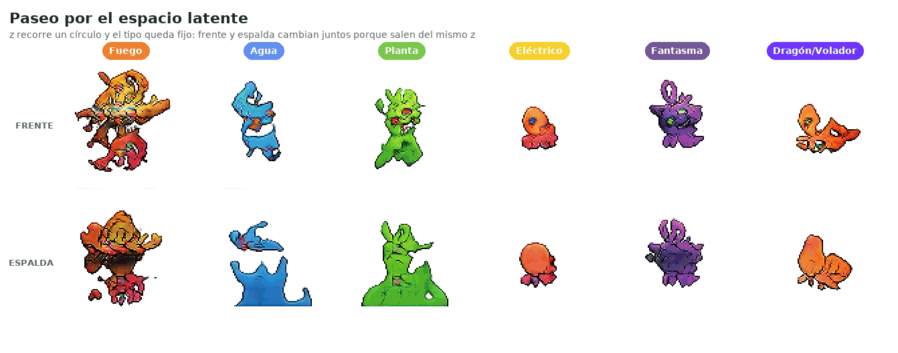
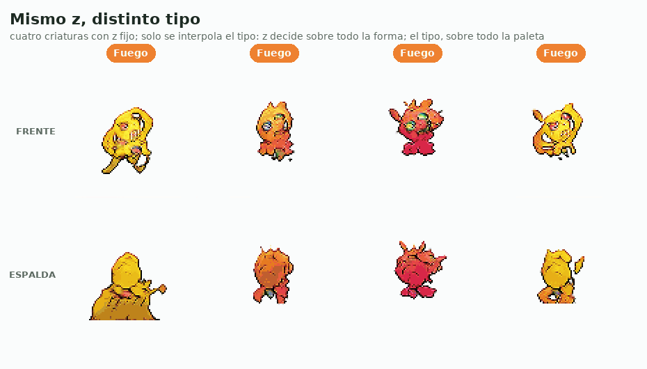
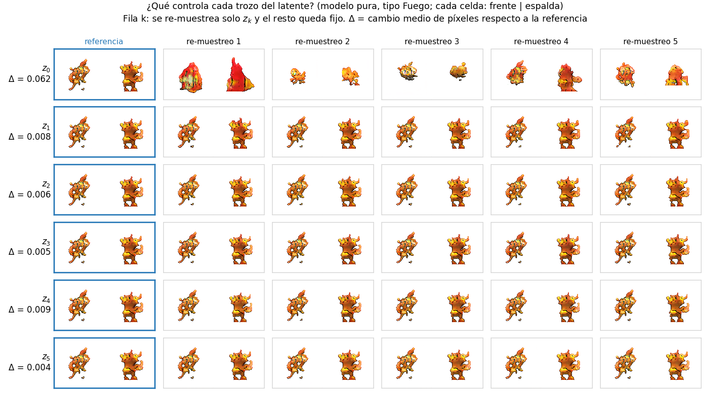
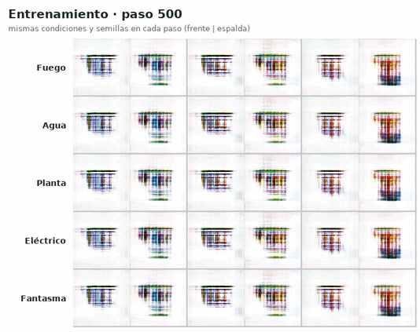
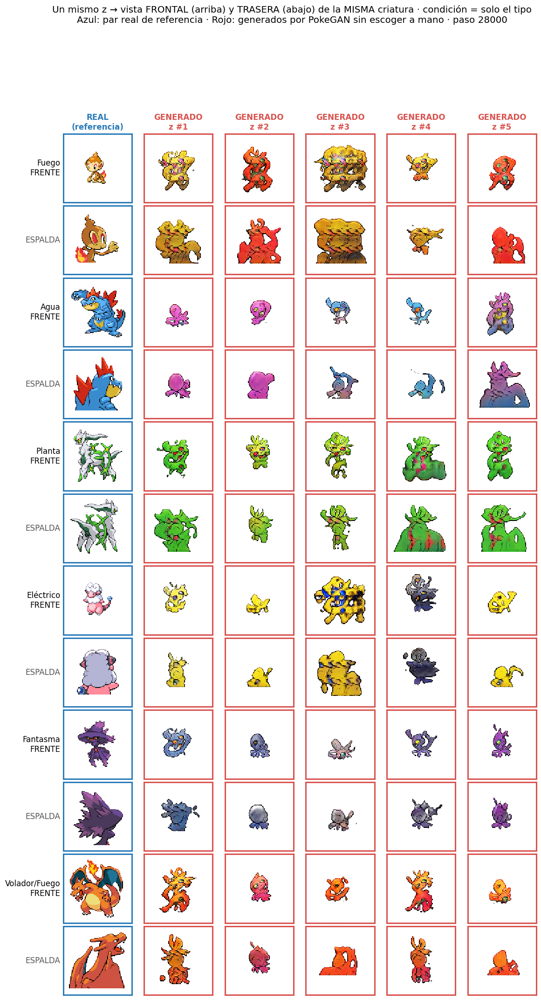
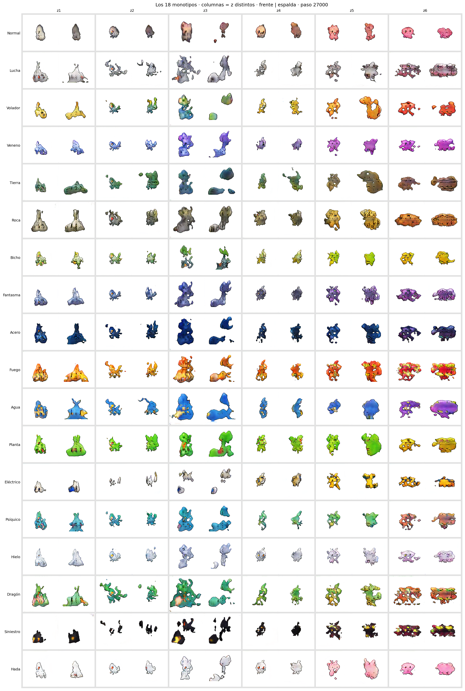
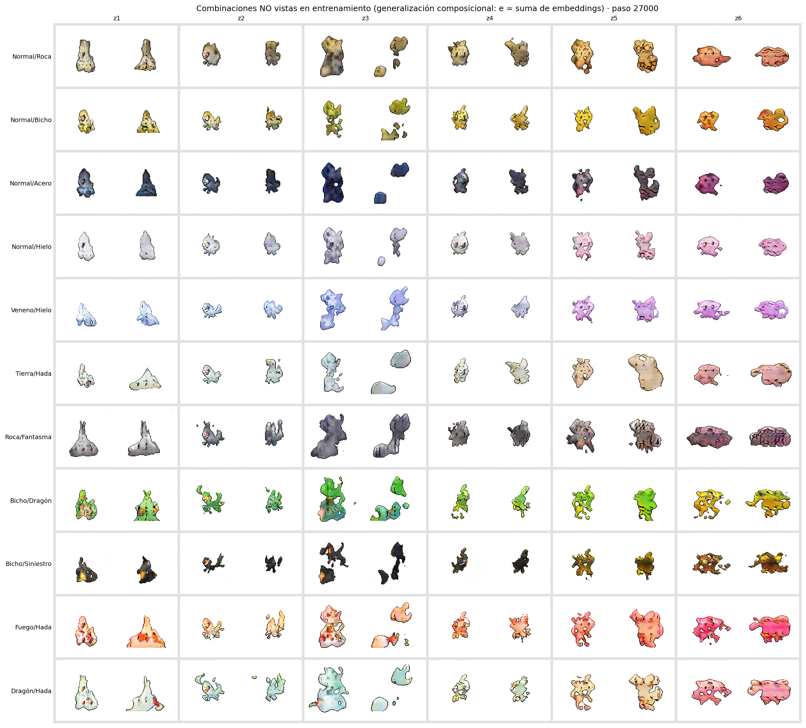

<div align="center">

# PokeGAN

**Generación condicional de criaturas en pixel art, de frente y de espalda, a partir de su tipo.**

Desarrollado por **Luis Contreras**


[**Demo en el navegador**](https://luiscontreras73.github.io/pokegan/) ·
[Notebook](notebooks/PokeGAN_Colab.ipynb) ·
[Derivaciones](docs/matematica.md) ·
[Reproducir](#5-reproducibilidad) ·
[Citar](#cómo-citar)



<sub><b>Figura 1.</b> Paseo por el espacio latente (modelo <code>vision</code>). Cada columna recorre un círculo máximo
de z con el tipo fijo; frente y espalda cambian juntos porque salen del mismo z.</sub>

</div>

## Resumen

PokeGAN es una red generativa antagónica (GAN) condicional que aprende la distribución conjunta de las dos vistas de un
sprite, frente y espalda, condicionada solo por el tipo: uno o dos de 18, codificados en multi-hot. Un mismo vector latente
$z\in\mathbb R^{120}$ produce ambas vistas, de 96×96 px, mediante un generador estilo BigGAN con tronco compartido y dos
cabezas. Un discriminador de proyección juzga el par completo, y un término antagónico por pares penaliza frentes y
espaldas de criaturas distintas. Con 7 739 pares de entrenamiento y unas 3,5 horas en una sola GPU, el modelo entrenado
íntegramente desde cero alcanza 0,93 de la coherencia frente/espalda de los pares reales y 0,88 de su diversidad dentro de
cada tipo, con KID×10³ de 24,0 (frente) y 42,8 (espalda). Una variante que añade, solo durante el entrenamiento, un
discriminador auxiliar sobre características congeladas de ConvNeXt-T reduce el KID a 16,2 y 17,4. Se publican el código,
los pesos, la evaluación completa y una demo que ejecuta el generador en el navegador.

## Contenido

1. [Problema](#1-problema) · 2. [Método](#2-método) · 3. [Resultados](#3-resultados) ·
4. [Análisis](#4-análisis-lo-que-falló-y-cómo-se-corrigió) · 5. [Reproducibilidad](#5-reproducibilidad) ·
6. [Demo](#6-demo) · 7. [Estructura](#7-estructura-del-repositorio) · 8. [Limitaciones](#8-limitaciones-y-trabajo-futuro)

## 1. Problema

Sea $y\in\{0,1\}^{18}$ con $\lVert y\rVert_1\in\{1,2\}$ el tipo de una criatura, y $(x_f, x_b)$ su par de sprites frontal y
trasero. El objetivo es aprender un generador $G(z, y) = (x_f, x_b)$, con $z\sim\mathcal N(0, I)$, tal que:

- **Condicionamiento:** $G(\cdot, y)$ produce criaturas reconocibles del tipo $y$, incluidas combinaciones ausentes de los datos.
- **Coherencia:** frente y espalda salen del **mismo** $z$ y son la misma criatura (paleta, anatomía, detalles).
- **Diversidad y novedad:** distintos $z$ dan criaturas distintas que no copian el conjunto de entrenamiento.

El tipo es la **única** condición: especie, forma o colección se usan solo para curar los datos, ponderar el muestreo y
construir negativos, nunca como entrada de $G$.

## 2. Método

La arquitectura parte de BigGAN ([Brock et al. 2018](https://doi.org/10.48550/arXiv.1809.11096)) en versión reducida,
con un discriminador de proyección ([Miyato y Koyama 2018](https://doi.org/10.48550/arXiv.1802.05637)) adaptado a dos
vistas. No hay encoder ni prior aprendido: $G$ aprende solo de la señal del discriminador. Las derivaciones completas
están en [`docs/matematica.md`](docs/matematica.md).

### 2.1 Generador (8,42 M parámetros)

```text
 z ∈ R^120 ─► [ z0 | z1 | z2 | z3 | z4 | z5 ]            (6 trozos de 20: z jerárquico)
 y ∈ {0,1}^18 ─► e = Eᵀy (suma de embeddings de tipo) ─► ê = λ_t · RMSNorm(e)

 z0 ─► SNLinear ─► 512×3×3
        GBlock  CBN[z1; ê]   512 → 512    6×6
        GBlock  CBN[z2; ê]   512 → 256   12×12          tronco compartido
        GBlock  CBN[z3; ê]   256 → 128   24×24
        Self-Attention               24×24
        GBlock  CBN[z4; ê]   128 →  64   48×48
              ┌────────────────┴─────────────────┐
        cabeza FRENTE                      cabeza ESPALDA            (pesos separados)
        GBlock CBN[z5; ê] 64→32  96×96     GBlock CBN[z5; ê] 64→32  96×96
        BN-ReLU-SNConv3 → (rgb_f, a_f)     BN-ReLU-SNConv3 → (rgb_b, a_b)
        x_f = σ(a_f)·tanh(rgb_f) + (1−σ(a_f))   x_b = σ(a_b)·tanh(rgb_b) + (1−σ(a_b))   (composición alfa sobre blanco)

 GBlock = CBN → ReLU → Up×2 → SNConv3 → CBN → ReLU → SNConv3, atajo Up + SNConv1
 CBN(h | s) = (1 + W_γ s) ⊙ BN(h) + W_β s,   s = [z_ℓ ; ê]
```

### 2.2 Discriminador (9,62 M parámetros)

```text
 [x_f ; x_b]  6×96×96   (frente y espalda apilados; la misma DiffAugment en ambas vistas)
   DBlock 6→32 @48 · DBlock 32→64 @24 · Self-Attention · DBlock 64→128 @12
   DBlock 128→256 @6 · DBlock 256→512 @3 · DBlock 512→512 @3 · ReLU · suma global ─► φ ∈ R^512
   C_uc = ψ(φ)                 realismo del par
   C_c  = ψ(φ) + ⟨V y, φ⟩      realismo + correspondencia con el tipo (y multi-hot, sin normalizar)
```

Todas las capas de $G$ y $D$ usan normalización espectral ([Miyato et al. 2018](https://doi.org/10.48550/arXiv.1802.05957)).

### 2.3 Objetivo

Con la pérdida hinge y un término **relativista por pares** que compara el par real $i$ con el frente de $i$ unido a la
espalda de otra especie $j$:

$$
H(C)=\mathbb E_{\text{real}}[1-C]_+ +\mathbb E_{\text{falso}}[1+C]_+ +\tfrac12\,\mathbb E_{i}[1-C(f_i,b_i)+C(f_i,b_j)]_+
$$

$$
\mathcal L_D=H(C_{uc})+\lambda_t H(C_c)+0.3\,[R_{LC}(C_{uc})+\lambda_t R_{LC}(C_c)],\qquad
\mathcal L_G=-\mathbb E[C_{uc}]-\lambda_t\,\mathbb E[C_c]
$$

$\lambda_t$ lleva el modelo de incondicional a condicional entre el 10 % y el 40 % del entrenamiento
([Shahbazi et al. 2022](https://doi.org/10.48550/arXiv.2201.06578)), y $R_{LC}$ es la regularización LeCam
([Tseng et al. 2021](https://doi.org/10.48550/arXiv.2104.03310)) con anclas móviles separadas para cada logit.

### 2.4 Entrenamiento

| Etapa | Configuración | Pasos | Qué añade |
|---|---|---|---|
| Principal | [`configs/main.yaml`](configs/main.yaml) | 0 → 24 000 | el modelo completo desde pesos aleatorios |
| Afinado de forma | [`configs/forma.yaml`](configs/forma.yaml) | 24 000 → 27 000 | penalización de área visible y de perímetro TV(α) (§10c de las derivaciones) → modelo **`pura`** |
| Variante `vision` | [`configs/vision.yaml`](configs/vision.yaml) | 27 000 → 28 000 | discriminador auxiliar sobre ConvNeXt-T congelado ([Kumari et al. 2022](https://doi.org/10.48550/arXiv.2112.09130)) → modelo **`vision`** |

Hiperparámetros comunes: batch 64; Adam con $\beta=(0, 0.999)$, $\eta_G=10^{-4}$, $\eta_D=4\cdot10^{-4}$ (TTUR); 2 pasos de
$D$ por paso de $G$; DiffAugment pareado de traslación y cutout, sin aumentos de color porque el color es la señal del
tipo ([Zhao et al. 2020](https://doi.org/10.48550/arXiv.2006.10738)); volteo horizontal conjunto de ambas vistas; EMA
de $G$ con decaimiento 0,999 y estadísticas de BatchNorm recalculadas antes de muestrear; fp32 con TF32; semilla 0.

En **`pura`** ninguna red preentrenada participa del entrenamiento. En **`vision`** la red preentrenada solo actúa como
juez durante 1000 pasos: el generador conserva la misma arquitectura y al muestrear no usa ConvNeXt.

## 3. Resultados

### 3.1 Métricas

Evaluación completa del modelo `pura`: 3000 pares por semilla, semillas 0 y 1, media ± desviación entre semillas, salida
cruda del generador sin selección manual. «Normalizado» = (generado − piso)/(techo − piso), o generado/real si no hay piso.

| Dimensión | Generado | Techo (reales no vistos) | Piso | Normalizado |
|---|---|---|---|---|
| KID×10³ frente ↓ | 24,03 ± 0,20 | 3,07 | — | — |
| KID×10³ espalda ↓ | 42,75 ± 0,47 | 2,44 | — | — |
| Tipo: acierto del conjunto (sonda lineal sobre DINOv3) | 0,170 | 0,228 | 0,047 | **0,68** |
| Tipo: mAP (ResNet-18 entrenada desde cero) | 0,213 | 0,238 | 0,084 | **0,84** |
| Coherencia frente/espalda (intersección de paletas) | 0,600 ± 0,001 | 0,634 | 0,109 | **0,93** |
| Diversidad por tipo (Vendi, criaturas efectivas) | 3,7 | 4,2 | — | **0,88** |
| Diversidad por tipo (distancia coseno, Inception) | 0,271 | 0,301 | — | **0,90** |
| Lienzos vacíos (< 240 px de primer plano) | 0,1 % | 0 % | — | — |

Comparación de los dos modelos con las mismas semillas (2000 pares):

| Modelo | KID×10³ frente ↓ | KID×10³ espalda ↓ | Tipo: mAP / acierto ↑ | Coherencia ↑ | Vacíos ↓ |
|---|---|---|---|---|---|
| `pura` | 23,6 | 41,8 | **0,222 / 0,190** | **0,600** | 0,1 % |
| `vision` | **16,2** | **17,4** | 0,203 / 0,159 | 0,568 | **0,0 %** |

`vision` reduce a menos de la mitad el KID de la espalda y hace aparecer ojos y extremidades, a costa de algo de fidelidad
de tipo y de coherencia. Como Inception y ConvNeXt comparten rasgos de ImageNet, parte de la mejora en KID puede reflejar
esa afinidad ([Kynkäänniemi et al. 2023](https://doi.org/10.48550/arXiv.2203.06026)). Tablas completas, incluido el
desglose por tipo: [`results/eval_forma/metrics.md`](results/eval_forma/metrics.md) (evaluador DINOv3) y
[`results/eval_forma_desde_cero/metrics.md`](results/eval_forma_desde_cero/metrics.md) (evaluador entrenado desde cero).

### 3.2 Qué aprendió el modelo

<p align="center"></p>

<sub><b>Figura 2.</b> Mismo z, distinto tipo (modelo <code>vision</code>). Se interpola solo la condición, que entra de
forma lineal en el embedding: z decide sobre todo la forma y el tipo, sobre todo la paleta.</sub>



<sub><b>Figura 3.</b> Contribución de cada trozo de z (modelo <code>pura</code>). Re-muestrear $z_0$ cambia la imagen un
orden de magnitud más (Δ = 0,062) que cualquier otro trozo (Δ ≤ 0,009): la forma se decide en el tallo de 3×3. No es
colapso de modos, sino subutilización del latente (análisis en §10c de las derivaciones).</sub>

<p align="center"></p>

<sub><b>Figura 4.</b> Evolución del entrenamiento principal con condiciones y semillas fijas, del paso 500 al 24 000.</sub>



<sub><b>Figura 5.</b> Muestras sin selección manual del modelo <code>vision</code>. En cada columna, arriba el frente y abajo
la espalda de la misma criatura; la primera columna (azul) es un par real de referencia. Versión del modelo
<code>pura</code>: <a href="results/FRENTE_ESPALDA.png">FRENTE_ESPALDA.png</a>.</sub>

| | |
|---|---|
|  |  |
| <sub><b>Figura 6.</b> Los 18 tipos × 6 valores de z (frente \| espalda).</sub> | <sub><b>Figura 7.</b> Las 11 combinaciones ausentes del entrenamiento.</sub> |

### 3.3 Generalización y novedad

- **Combinaciones no vistas.** El modelo las genera (Figura 7), pero el evaluador reconoce ambos tipos en el top-2 en solo
  el 2,1 % de las muestras, frente al 7,3 % en combinaciones frecuentes vistas. La composición por suma de embeddings
  produce paletas intermedias, pero no siempre rasgos reconocibles de los dos tipos.
- **Novedad.** Ningún sprite real se reproduce ([vecinos más cercanos](results/eval_forma/nn_closest.png)). Aun así, en
  distancia L2 de píxeles las muestras quedan más cerca del entrenamiento que especies reales no vistas: mediana 24,6
  frente a 32,4. Esta distancia favorece las siluetas pequeñas y redondeadas, que son los vecinos más frecuentes.

## 4. Análisis: lo que falló y cómo se corrigió

| Síntoma | Diagnóstico | Corrección |
|---|---|---|
| $D$ devolvía una constante (−0,96) para toda entrada | Los negativos (falsos y desajustados) pesaban más que los positivos: el óptimo de hinge era responder siempre «falso». Confirmado con $D$ aislado y ablaciones. | Rebalancear pesos creó una trampa simétrica en +1; la forma **relativista por pares** cancela el sesgo de $D$ y resuelve ambas (§6.x). |
| La proyección de tipo se volvió anti-discriminativa | LeCam aplicado solo al logit condicional: la red «pagaba» la regularización con la proyección | LeCam en **ambos** logits con anclas separadas (§7.5). |
| 8,8 % de lienzos casi vacíos | Ningún sprite real tiene < 240 px de primer plano: $G$ ponía masa fuera del soporte de los datos | Penalización de área visible y de perímetro TV(α) sobre la imagen compuesta: **0,1 %** (§10c). |
| Siluetas fragmentadas aunque el KID mejoraba | $D$ juzga **nitidez**, no forma: desenfocar un sprite real le cuesta el 94 % de la brecha real–falso; fragmentarlo, el 3 % | Discriminador auxiliar preentrenado (`vision`); también se implementaron discriminadores multiescala y de silueta ([`configs/multiescala.yaml`](configs/multiescala.yaml)), sin entrenamiento completo. |
| ¿Colapso del latente? | No: $z_0$ explica casi toda la variación (Sobol $S_T=0{,}89$; Figura 3) y el modelo usa ≈ 20 de 120 dimensiones | Una ruta espacial para $z_1..z_4$ no cambió el uso: la pérdida GAN es indiferente a cuántas dimensiones se usen (§10c). |
| Guiar el muestreo con $D$ (DDLS, DGflow, SIR, DRS) | No mejora: $D$ está sobreajustado y LeCam comprimió sus logits (calibración de Platt, β = 7,8) | Resultado negativo medido (§10b); solo la restricción de soporte ayuda. |

Las referencias § apuntan a [`docs/matematica.md`](docs/matematica.md).

## 5. Reproducibilidad

### 5.1 Entorno

Probado con Python 3.14, PyTorch 2.11 (CUDA 12.8), NumPy 2.4, timm 1.0, transformers 5.12 y torch-fidelity 0.4.0, en
Windows 11 con una NVIDIA RTX 4070 SUPER (12 GB). El muestreo también funciona en CPU.

```bash
python -m venv .venv
source .venv/bin/activate                 # Windows: .venv\Scripts\activate
pip install torch torchvision             # para CUDA, el comando de https://pytorch.org
pip install -e ".[eval,web,demo,dev]"
python -m pytest -q                       # 60 pruebas en CPU
```

### 5.2 Pesos publicados

[`weights/`](weights/) contiene ambos generadores: `G_ema` en fp16, unos 16 MB cada uno, con las estadísticas de
BatchNorm ya recalculadas. Reproducen los checkpoints de entrenamiento con una diferencia media de 0,01/255 por píxel.

```bash
python scripts/generate.py --ckpt weights/pokegan_vision.pt --types fuego volador --n 8 --seed 0
python scripts/generate.py --ckpt weights/pokegan_pura.pt --types fire fairy --n 8 --seed 0     # combinación no vista
python scripts/make_readme_media.py          # Figuras 1–4 (results/media/)
python scripts/make_figures.py --ckpt weights/pokegan_pura.pt --out results/figuras
```

```python
import sys; sys.path.insert(0, "src")
from pokegan.sample import load_generator, generate
G, info = load_generator("weights/pokegan_vision.pt")
pares = generate(G, ["planta", "veneno"], n=4, seed=42, lam=info["lam"])   # uint8 [4, 2, 96, 96, 3]: frente, espalda
```

### 5.3 Datos

El conjunto de entrenamiento no se redistribuye: los sprites son propiedad de Nintendo, Creatures Inc. y GAME FREAK inc.
Son 12 806 pares frente/espalda de las 1025 especies, construidos a partir de
[PokeAPI/sprites](https://github.com/PokeAPI/sprites). El código espera:

```text
data/Pokemon/pairs.csv     una fila por par: front_path, back_path, type_normal … type_fairy (multi-hot de 18),
                           species_id, is_shiny, source_collection (además de metadatos que no se usan)
data/Pokemon/images96/     PNG RGB de 96×96 con fondo blanco, rutas relativas a data/Pokemon/
```

`python scripts/prepare_data.py` construye la caché `data/cache/pairs96.npz` y aplica la curaduría declarada:

- solo colecciones Gen 3, 4, 5 y `default` (8 085 pares, las 1025 especies, 162 de las 171 combinaciones);
- el 5 % de las especies se reserva para validación, sin fuga entre especies;
- la GAN entrena con 7 739 pares (972 especies, 160 combinaciones);
- pesos de muestreo $w\propto n_{\text{pares}}(\text{especie})^{-0.5}\cdot n_{\text{especies}}(\text{combo})^{-0.25}\cdot(0.5\text{ si shiny})$.

### 5.4 Entrenamiento desde cero

```bash
python scripts/train.py --config configs/main.yaml  --iters 24000                                  # ≈ 3 h
python scripts/train.py --config configs/forma.yaml --resume runs/main/ckpt_024000.pt --iters 27000  # ≈ 20 min → pura
python scripts/train.py --config configs/vision.yaml --resume runs/main_forma/last.pt --iters 28000 # ≈ 20 min → vision
python scripts/export_weights.py                                                                     # → weights/
```

El entrenamiento se puede reanudar (`--resume auto`); `--benchmark 200` mide la velocidad antes de fijar `--iters`. Con la
misma semilla, las curvas se reproducen salvo por el no determinismo de cuDNN en GPU.

### 5.5 Evaluación

```bash
python scripts/train_type_classifier.py     # evaluador de tipos desde cero → runs/type_classifier/best.pt
python scripts/train_type_probe.py          # sonda lineal sobre DINOv3/ConvNeXt congelados → runs/type_probe/best.pt
python scripts/evaluate.py --ckpt weights/pokegan_pura.pt --n 3000 --seeds 0 1 --clf runs/type_probe/best.pt --out results/eval_forma
python scripts/evaluate.py --ckpt weights/pokegan_pura.pt --n 3000 --seeds 0 1 --out results/eval_forma_desde_cero
```

Las redes preentrenadas (Inception-v3 vía torch-fidelity, DINOv3 y ConvNeXt) se usan **solo para evaluar**, nunca como
pérdida del modelo `pura`. DINOv3 requiere aceptar su licencia en Hugging Face.

## 6. Demo

- **En el navegador:** [luiscontreras73.github.io/pokegan](https://luiscontreras73.github.io/pokegan/). Los generadores,
  exportados a ONNX (`python scripts/export_web.py`), corren con ONNX Runtime Web: WebGPU si está disponible, si no
  WebAssembly, unas 6 criaturas por segundo en CPU. Nada se envía a un servidor. La página ([`web/`](web/)) se publica con
  GitHub Actions.
- **Notebook:** [`notebooks/PokeGAN_Colab.ipynb`](notebooks/PokeGAN_Colab.ipynb), para Colab o Jupyter. Usa el paquete de
  `python scripts/export_colab.py`.
- **Aplicación local:** `python scripts/demo_app.py` (FastAPI), en http://127.0.0.1:8000.

## 7. Estructura del repositorio

```text
.
├── src/pokegan/          paquete: modelos, pérdidas, datos, aumentos, entrenamiento, muestreo y evaluación
│   └── models/           generator.py, discriminator.py, layers.py, vision_d.py, multiscale_d.py
├── configs/              main.yaml, forma.yaml, vision.yaml (+ smoke.yaml para pruebas, experimentos)
├── scripts/              preparar datos, entrenar, generar, evaluar, figuras, exportar (pesos, web, Colab), demo
├── weights/              generadores publicados (pokegan_pura.pt, pokegan_vision.pt)
├── results/              métricas (eval_forma*/), figuras (figuras/, media/) y muestras
├── docs/                 matematica.md (derivaciones), papers.md (bibliografía comentada)
├── notebooks/            PokeGAN_Colab.ipynb
├── web/                  demo estática (HTML, CSS, JS y modelos ONNX)
└── tests/                pruebas en CPU
```

## 8. Limitaciones y trabajo futuro

- **Forma.** Las siluetas de `pura` siguen siendo blandas y a veces fragmentadas. El discriminador desde cero mide
  nitidez antes que forma; los discriminadores multiescala y de silueta quedaron implementados pero sin un
  entrenamiento completo.
- **Composición de tipos.** Las combinaciones no vistas se reconocen poco (§3.3). Una salida de paleta indexada compartida
  por ambas vistas podría acercar el resultado al pixel art: el 95 % de los píxeles de la espalda usan un color exacto
  del frente.
- **Uso del latente.** El modelo concentra la variación en $z_0$. Regularizadores de uso del latente o una inyección
  espacial de $z$ desde el inicio del entrenamiento son la siguiente prueba natural.
- **Métricas.** Inception está fuera de dominio para pixel art de 96 px; por eso el KID se acompaña de evaluadores de tipo,
  coherencia y diversidad calibrados con techo y piso reales.
- **Un solo entrenamiento por configuración.** Las ablaciones de la §4 son diagnósticas, no un barrido estadístico.

## Cómo citar

```bibtex
@software{contreras2026pokegan,
  author  = {Contreras, Luis},
  title   = {{PokeGAN}: generación condicional de criaturas de frente y de espalda a partir de su tipo},
  year    = {2026},
  version = {1.0.0},
  url     = {https://github.com/LuisContreras73/pokegan},
  license = {MIT}
}
```

Los metadatos también están en [`CITATION.cff`](CITATION.cff).

## Licencia y créditos

El código y los pesos se distribuyen bajo licencia [MIT](LICENSE). Pokémon y sus sprites son marcas y propiedad de
Nintendo, Creatures Inc. y GAME FREAK inc. Este es un proyecto académico sin afiliación: el conjunto de datos no se
redistribuye y las figuras con sprites reales se incluyen solo como referencia. Las criaturas generadas, sus nombres en
la demo, el logotipo y los íconos de tipo son originales de este proyecto.
